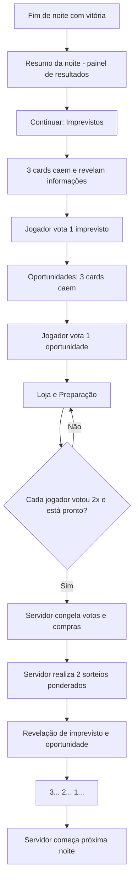

# P.I.A.R.I.A / ScaryParty — Plano de Implementação
## Preparação entre Noites 2.1 — UI Toolkit First + Feel + DOTween Pro + Votação Ponderada + TAB

**Status:** revisão da especificação para implementação, não aplicada ao código. **Revisão 2.1: sem estética de caderno; UI visual 100% UI Toolkit; feedbacks intensificados.**  
**Branch de referência auditada:** `release/marcos-noturnos` do repositório `TavernaDasMilPortas/ScaryParty` (consultada em 18/11/2026).  
**Escopo:** apresentação de resultados de noite, duas votações, loja/preparação, sorteio, contagem regressiva, transferência dos indicadores para TAB, animações e efeitos; integração ao ciclo de noites e multiplayer.  
**Terminologia da interface:** usar **Imprevistos** (seleção visual feita na proposta anterior); permitir no theme/config trocar o rótulo para **Complicações**, sem renomear `RunModifierKind.Hindrance` no domínio. A escolha do texto não afeta os dados.

---

# 0. OBJETIVO E REGRAS INEGOCIÁVEIS — REV 2.1

> **NÃO FAZER UMA UI DE CADERNO.** A metáfora de "selo caindo" descreve **somente o movimento**: cards surgem de cima, ganham peso, dão um impacto leve, fazem um *overshoot* e assentam, e só então revelam o conteúdo. Não desenhar papel rasgado, fichas de caderno, clipes, folhas, fichários, scrapbook, fita adesiva, carimbos de tinta ou viradas de página.

1. **Visual:** seguir a identidade P.I.A.R.I.A das outras telas, mas como **interface digital de jogo cartoon**: fundos pêssego/creme, contorno marrom espesso, painéis limpos e sólidos, botões coloridos, tipografia e grafismos já existentes. Remover metáfora física de caderno da arte, dos textos, das transições e dos efeitos de som.
2. **Tecnologia principal e exclusiva para todos os elementos VISUAIS dos menus:** **Unity UI Toolkit runtime**: UXML (estrutura), USS (estilo) e C# (binding/comportamento). Usar `VisualElement`, `Button`, `Label`, `ScrollView`, `ProgressBar`, `TemplateContainer` e pseudo-states/classes USS. Não criar novos `Canvas`, `RectTransform`, `UnityEngine.UI`, `TextMeshProUGUI`, IMGUI/`OnGUI`, World Space UI, Prefabs uGUI, câmeras de UI ou efeitos sobrepostos com GameObjects para apresentar essa experiência.
3. **Feel e DOTween não substituem o UI Toolkit.** DOTween/serviço `UIToolkitTweenService` movimentam/progridem propriedades dos **VisualElements**; Feel (`MMF_Player`) dispara áudio, feedbacks globais opcionais e sinais de sequenciamento. Qualquer brilho, flash, indicador, shake, confete estilizado, badge de status virtual ou destaque visual de UI será desenhado/animado por **VisualElements** dentro do mesmo `UIDocument` (sem partículas de `ParticleSystem` sobre o menu). GameObjects dos MMF_Players ficam apenas como controladores não visuais.
4. **Responsividade máxima com hierarquia:** todo clique válido precisa de resposta imediatamente; confirmação real somente após rede/servidor; erros devem oferecer som, cor/ícone, estado e microanimação, nunca só som ou tremor. Feedback deve ajudar a identificar o estado, não só gerar ruído visual.
5. Conservar `RunProgressionService`, `NightCycleService`, `PizzeriaNetworkState`, `PizzeriaCommandHandler`, `ReplicationProjector` e evoluí-los incrementalmente; não duplicar lógica de dinheiro, compra, preparação ou progressão.
6. **O servidor decide** opções, votos, chances, resultados, lock e começo da noite. Os clientes desenham/animam esses estados. Não atrelar a lógica a um `OnComplete` de tween ou MMF_Player.
7. Fluxo: **Resumo → Imprevistos (3 cards) → Oportunidades (3 cards) → Loja/Preparação → Todos prontos → Sorteios → Revelação → 3,2,1 → Próxima noite**. Cada jogador faz um voto por categoria; o resultado de cada categoria usa 100% dos votos da respectiva categoria.
8. Abas 100% funcionais, navegáveis e acessíveis após a primeira visita obrigatória. Ao iniciar sorteio, lock em alterações e navegação para apresentação sincronizada.
9. Preservar tutorial/Noite 0, derrota, vitória final, retry, debug sem tempo, quedas de rede e reconexão; não abrir votação após última noite.
10. Construir um **catálogo de feedbacks** orientado por eventos: hover, press, soltar, seleção, troca de voto, confirmação de RPC, rejeição, compra, falta de saldo, ready, unready, chegada de jogador, desconexão, mudanças de valores, revelação, sorteios, countdown e transição. Parametrizar intensidades/durações no Odin. Respeitar `ReduceMotion`, opções de áudio e limite de efeitos simultâneos.
11. Usar ícones importados localmente de banco grátis com licença compatível, preferindo assets já presentes; **nenhuma dependência de rede em runtime**.
12. Parâmetro de aceite obrigatório: se um menu do plano for visualizado por qualquer renderizador que não seja UI Toolkit, **a implementação está fora do escopo aprovado**, mesmo que pareça correta.

---

# 1. AUDITORIA DO REPOSITÓRIO E IMPACTO REAL

### Fontes existentes a ler e preservar

| Arquivo | Constatação e ação |
|---|---|
| `ScaryParty/Assets/Piaaria/Scripts/Pizzeria/Presentation/RunPreparationPresenter.cs` | Modal atual de 720 px com votação em 2 botões de 58 px, seis botões de loja, upgrades em texto e ready. Substituir camada visual; manter comandos sob um adapter/mediator. |
| `.../Presentation/NightResultsPresenter.cs` | Exibe vitória/derrota/resultados e botão host `AdvanceToNextNightServerRpc`. Reunificar o fluxo visual para que o **resumo seja a primeira página**, sem duas telas sobrepostas; preservar derrota, tutorial e vitória final. |
| `.../Domain/Services/RunProgressionService.cs` | Um único array de opções misturadas, dicionário único de votos e maior votação vence. Evoluir para dois conjuntos tipados, 3 opções por conjunto, votos separados e resultado ponderado. |
| `.../Network/PizzeriaCommandHandler.cs` | `AdvanceToNextNightServerRpc` abre votação de 2 opções; `SetRunReadyServerRpc` imediatamente resolve e começa noite. Substituir por fase de revelação temporizada no servidor. |
| `.../Network/NetDtos.cs` | `NetRunStateDto` só prevê `OptionA/OptionB`, um vencedor e `ReadyCount`. Estender modelo de estado e serialização de modo compatível com os consumidores locais. |
| `.../Network/ReplicationProjector.cs` | Projetor mapeia só duas opções e um voto; adaptar projeção, contagens, revisões e resultados de ambas as categorias. |
| `.../UI/Piaria/Scripts/Runtime/Presenters/ScoreboardPresenter.cs` | Tab atual exibe nome, pizzas na mão e dinheiro individual. Reformar em painel operativo e migrar lógica de tecla sem conflitos. |
| `.../UI/Piaria/Scripts/Runtime/Presenters/HudPresenter.cs` | Banner concentra Noite, Fase/Tempo, Meta, Caixa e Reputação; há status de equipe. Reduzir poluição, mover métricas para TAB, sem perder feedback crítico contextual. |
| `.../UI/Piaria/Scripts/Runtime/Core/UIToolkitTweenService.cs` | **JÁ existe** wrapper DOTween com `FadeIn/Out`, `PopIn/Out`, `SlideIn`, cancelamento de tweens e `ReduceMotion`. **Estender**, em vez de recriar. |
| `.../UI/Piaria/USS/PiariaCommon.uss` | Tokens visuais existentes: `#f8d5c4`, `#ffebd5`, `#402318`, `#ff741f`, amarelo, azul, verde, vermelho; manter. |
| `.../UI/Piaria/UXML/ReadyRoomScreen.uxml` e `.../USS/ReadyRoom.uss` | Reutilizar padrão de cards de jogador/prontidão. |
| `.../UI/Piaria/UXML/ScoreboardOverlay.uxml` / `USS/Scoreboard.uss` | Atualizar Tab reutilizando linguagem de cores, contornos e tipografia, com painéis digitais sólidos e indicadores de status. |

**Problema importante de catálogo:** `RegisterDefaultCatalog()` atualmente só tem 2 itens explicitamente `Hindrance` (`vampire_attack`, `heavy_rush`), 1 `Opportunity` (`express_supply`), 1 `Event` (`blood_moon`) e 3 upgrades permanentes. **Não é possível mostrar 3 + 3 reais sem ampliar o catálogo e ligar seus efeitos ao gameplay.**

**Não inventar compatibilidade:** confirmar versão de DOTween instalada, mapeamento do Feel, assembly definitions, inclusão de SVG/Vector Graphics, pontos exatos onde `RunEffectiveStats` afetam sistemas e a branch de trabalho efetiva antes de editar. Referência pode ter mudanças ainda não integradas.

---

# 2. NOVO FLUXO VISUAL E FUNCIONAL



## 2.1. Shell visual único e abas (sem metáfora de caderno)

Criar `NightIntermissionScreen.uxml`, `NightIntermission.uss` e subtemplates reutilizáveis **100% UI Toolkit**. Layout 16:9 seguro em 1280×720, escala fluida, largura relativa e largura máxima coerente com Lobby/ReadyRoom. Visual com **painéis cartoon sólidos, contornos grossos, fundos suaves, linhas divisórias limpas, ícones e botões do padrão Piaria**. Não copiar literalmente sprites de papel, moldura de fichário, clipes, carimbos ou rasgos. Reaproveitar tokens de cor, fontes e identidade, sem a metáfora material.

- **Resumo** (primeiro, obrigatoriamente): indicadores, destaques positivos/negativos, botão de continuar.
- **Imprevistos** (3 cards grandes): entrada com impacto e revelação de conteúdo, um voto.
- **Oportunidades** (3 cards grandes): entrada com impacto/revelação, um voto.
- **Loja** (6 cards de upgrade): compra e feedback de orçamento/status.
- **Preparar** (2 votos, efeitos, equipe): status individual, confirmações e pronta para avançar.

**Abas são abas digitais**, visual tipo navegação/segmentos do jogo: selected state, ícone de fase, pequeno indicador de conclusão, hover/focus/click e transição de conteúdo com fade/slide lateral discreto. Não simular virada física de página. Barra superior: próxima noite, caixa, progresso das etapas; rodapé: participantes/ready + CTA contextual. Manter escala e foco de teclado consistentes.

Durante **Revelação**, desabilitar abas e substituir o corpo pelo sorteio e cards vencedores, mantendo shell digital. Aba escolhida é local por jogador; fase locked/reveal/countdown é sincronizada globalmente.

**Padrão de interação:** resposta no pointer-down; clique acionado apenas no click válido; confirmação de voto/compra via servidor; estados visuais `normal`, `hover`, `pressed`, `focused`, `selected`, `pending`, `confirmed`, `disabled`, `error`. Sempre preservar legibilidade sem hover.

## 2.2. Aba Resumo da Noite

Visual: **dashboard cartoon** com painel principal de resultados, cards de métricas, barra de progresso, indicadores e faixa de destaque para a conquista da noite. Painéis sólidos (sem recibos, folhas, pranchetas ou carimbos), ícones de sistema e hierarquia tipográfica clara.

Conteúdo real, sem dados fictícios: faturamento/meta, despesas por categoria (reposição, loja, equipe), saldo líquido calculado corretamente, entregas/pedidos, reputação/variação, causas relevantes quando dados existirem, total em caixa, próxima meta e duração. **Quando uma métrica não existir na rede, acrescentar snapshot explícito em vez de inventar valores.**

Animação: shell `Fade+Slide` 0,25s; barra de progresso preenche em 0,50s; números fazem *count-up visual* até o valor autoritativo (sem mudar dado); resultados favoráveis/piores entram com destaques distintos; três grupos de informação revelados com stagger. Botão `CONTINUAR` guia para Imprevistos. Feel: abertura curta, *tick* leve ao finalizar contadores, sucesso curto e sem ruído contínuo.

**Integração:** `NightPhase.Results` usa este resumo no mesmo shell para vitórias intermediárias; host libera preparação por comando existente após visualização. Não sobrepor `NightResultsPresenter` e o novo shell. Preservar derrota, tutorial, vitória final; não-host vê espera real de host, não um botão quebrado.

## 2.3. Aba Imprevistos — entrada com peso, impacto e revelação

Três cards horizontais, grandes e totalmente clicáveis (não apenas texto do botão). Cada card possui ícone, nome, explicação, efeito quantificado, duração e votos. **O termo "selo" refere-se apenas ao peso/impacto da animação, não um motivo gráfico.** O card é um **painel digital/cartoon de jogo**: borda forte, fundo sólido, sombra discreta criada por elementos/USS e destaque de seleção.

Sequência **somente na primeira abertura desta aba por sessão visual**:

| Tempo relativo | Animação feita em VisualElements | Feel (som/sinal) |
|---|---|---|
| 0.00s | Aba ativa e espaços dos cards aparecem com leve fade | *whoosh* de aba bem curto |
| 0.10–0.55s | Card 1 cai de Y=-90px, escala 1.04→0.97→1 e rotação -5°→+1°→0°; assenta | impacto cartoon baixo |
| 0.30–0.75s | Card 2 repete com atraso; não colide visualmente no card 1 | segundo impacto com pitch sutil |
| 0.50–0.95s | Card 3 repete; pequeno overshoot no pouso | terceiro impacto |
| 1.00s | Os 3 cards estabilizam; sem antecipar os textos | sinal único de conclusão |
| 1.05–1.50s | **Todos** os títulos, ícones, descrições e efeitos revelam em conjunto (fade + translate Y +8px→0); efeitos quantificados ficam em evidência | som de revelação discreto |
| 1.55s | Liberar pointer/keyboard para selecionar um card | pequeno feedback visual de habilitado |

**Não renderizar metáfora visual física** de selo, badge de status ou caderno. Durante a entrada, card pode ter apenas a forma-base sólida. Seleção: borda laranja, check `MEU VOTO`, escala discreta e uma pequena reação de estado. Se jogador mudar o voto antes do lock, animar saída do check anterior e entrada no novo; nunca contar dois votos.

Depois do voto confirmado pelo servidor, habilitar `PRÓXIMO: OPORTUNIDADES`. A aba é local; não forçar navegação dos demais jogadores.

## 2.4. Aba Oportunidades

Três cards de `RunModifierKind.Opportunity`, mesmos estados e timings, acentos verdes e amarelos da identidade existente, mesma queda/revelação conjunta; não usar folhas, papel ou fitas. Som levemente mais positivo na seleção, sem depender de cor para comunicar categoria. Ao votar, navegar sugeridamente para Loja.

## 2.5. Página Loja

Grid de 3 colunas × 2 linhas em desktop; fallback para 2/1 colunas quando necessário. Reaproveitar os seis itens atuais: timer do forno, bolsa reforçada, treinamento, suprimentos base +5, caixa, pizzaiolo. Card com ícone, nome, explicação, preço, compra, descrição de efeito, status comprado/limite atingido/indisponível/sem fundos.

Todas as compras passam pelo **RPC e validações existentes no servidor**. Para prevenir duplo clique: botão visualmente pendente enquanto aguarda resposta da rede (com timeout/feedback), sem debitar moeda localmente e sem informar sucesso antes do servidor replicar; desfazer pendência após rejeição; updates de caixa em todos os clientes. Aplicar Feel para som de moeda, badge digital `COMPRADO` e curta vibração em compra rejeitada; compras de outros clientes fazem cards atualizar sem animação exagerada. Opcional: um subpainel compacto de efeitos permanentes ativos.

## 2.6. Página Preparar

Resumo visual pequeno das duas escolhas individuais, votos na sessão, possíveis eventos e melhorias adquiridas. Jogadores em cards com status, porém **a fonte de verdade deve ser clientId + estado de ready do servidor**, não um bool local. `MARCAR COMO PRONTO` só habilita depois de registrar com sucesso um voto válido em **cada** categoria. `CANCELAR PRONTO` possível antes do lock; ao cancelar, pode reabrir voto/loja. Após marcar pronto, bloquear alterações do próprio jogador até desmarcar (mas permitir visualizar outras abas). Outros jogadores continuam comprando/votando; atualizar caixa e percentuais em tempo real.

Se algum jogador não votou nas duas categorias, exibir `Falta votar em Imprevistos/Oportunidades` com atalho para a aba exata. Mostrar `X/Y prontos` e nomes/avatares usando os dados já existentes do multiplayer.

## 2.7. Tela de Revelação final após todos prontos

Quando o servidor reconhece que todos os **participantes elegíveis, conectados e com ambos os votos confirmados** estão prontos:

1. Congelar imediatamente votos, ready, compras, cards e percentuais; persistir snapshot da votação e identificadores de sessão.
2. Executar no servidor **um sorteio ponderado independente para Imprevistos e outro para Oportunidades**; persistir ambos os resultados, sem aplicar duas vezes.
3. Publicar resultados, probabilidades congeladas e instante de início do reveal via estado replicado. UI muda para `A SORTE ESTÁ LANÇADA`.
4. Para cada categoria: mostrar três cards digitais, com chances congeladas visíveis; os destaques alternam *somente visualmente* durante ~1,2s (não alteram resultado), o card escolhido recebe destaque de borda, glow de UI Toolkit, som e escala; os outros perdem ênfase. Revelar Imprevisto e depois Oportunidade. **Duração de apresentação sugerida:** 4 a 6 segundos no total, configurável por Odin.
5. Exibir os dois selecionados lado a lado e texto `É isso que nos espera!`, com seus efeitos reais.
6. Iniciar `3 — 2 — 1` de forma sincronizada usando tempo de servidor. Ao final, servidor chama o start da noite; o shell UI Toolkit faz fade/slide e o input de gameplay só é liberado conforme fase efetiva da noite.

**Segurança:** não condicionar o início da noite a callbacks locais `OnComplete` do Feel/DOTween; um cliente lento, tela minimizada ou `ReduceMotion` nunca pode atrasar ou acelerar o servidor. `3/2/1` deriva de `NetworkManager.ServerTime.Time` com start e deadline replicados. Reentrada e reconexão leem o estágio/tempo atual e pulam etapas já transcorridas. Timeouts de revelação são fixados pelo servidor em segundos reais, não `Time.deltaTime` escalado.

---

# 3. REGRA EXATA DE PROBABILIDADE E SORTEIO

Para cada categoria `C`, o servidor soma votos válidos `totalVotes = sum(optionVotes)`.

**Chance da opção i:** `P(i) = votes(i) / totalVotes * 100`, desde que `totalVotes > 0`.

Exemplo 4 votos, 3 opções:

| Opção | Votos | Chance |
|---|---:|---:|
| A | 3 | 75% |
| B | 1 | 25% |
| C | 0 | 0% |

Sem desempate por maior votação. **Mesmo com 3 votos contra 1, opção B pode sair com 25%**. Não arredondar os pesos antes do sorteio; UI mostra percentual com arredondamento somente para exibição. Para garantir total visual de 100% com 3 opções, distribuir resíduos de arredondamento por método de maior resto ou exibir casas decimais.

Algoritmo autoritativo recomendado (sem soma de floats):

```csharp
int total = optionVotes.Sum();
if (total <= 0) return NoValidBallots; // não iniciar sorteio; tratar erro/preparação incompleta
int ticket = choiceRng.Next(0, total); // [0, total)
int cursor = 0;
for (int i = 0; i < optionVotes.Length; i++)
{
    cursor += optionVotes[i];
    if (ticket < cursor) return optionIds[i];
}
throw new InvalidOperationException("Inconsistent ballot snapshot");
```

**Garantias:** `ticket` nasce no servidor; RNG de escolha não usa nem interfere no RNG de cidade ou erros dos funcionários; resultado é persistido/idempotente, repetição de RPC não refaz roll; ordem das opções permanece estável em dados/serialização; votar sobrescreve voto por `clientId` + categoria; cliente só pode votar em um dos três IDs ofertados. Não permitir jogadores desconectados influenciarem total: remover votos/ready antes do lock. Depois do lock, manter um snapshot imutável mesmo que alguém desconecte.

**Nenhum voto:** não deve acontecer ao habilitar pronto só depois de ambos os votos válidos; se acontecer por erro de sincronização, abortar o lock com mensagem e permanecer em preparação, em vez de selecionar arbitrariamente. **1/1 = 100%** em sala solo.

**Quando aplicar efeitos:** sortear ambos em um único transaction/estado `Reveal`, aplicar ambos **uma única vez** antes do cálculo dos parâmetros da próxima noite e sinalizar `applied` em estado de domínio; início da noite apenas reutiliza os efeitos confirmados. Evitar expire prematuro das oportunidades/imprevistos de duração `OneNight`; verificar ciclo exato ao fechar/no começo da próxima noite.

---

# 4. MODELO DE DADOS E NETWORKING

**Preferir um único estado de preparação explícito e serializável**, não replicar apenas o texto de 2 botões. Sugestão de domínio:

```text
IntermissionId / RunGenerationId / TargetNight
IntermissionStage: Summary | BallotsOpen | Locked | Revealing | Countdown | Starting
ModifierOffers[2 categories][3 candidates]: id, kind, duration, metadata id
Votes[2 categories]: map clientId -> modifierId
ReadyPlayers: set<clientId>
FinalTally[2 categories]: count[3], total, probabilities/display
SelectedModifier[2 categories]: modifierId + appliedOnce
RevealStartedAtServerTime, CountdownStartsAt, StartNightAt
Revision
```

**Observação de arquitetura:** não é necessário sincronizar a aba pessoal selecionada; a tela local pode usar `Summary`, `Complications`, `Opportunities`, `Shop`, `Prepare` mesmo enquanto o servidor está em `BallotsOpen`. Fases `Locked`, `Revealing`, `Countdown` são globais.

**DTO/rede:** escolher DTOs de oferta/voto/resultado em `NetworkList` ou campos serializáveis de tamanho fixo (sempre 3 opções por categoria), conforme padrão existente. Expor **pelo menos** IDs, nomes/metadados resolvíveis, categorias, votos públicos, confirmação de voto próprio (sem depender de inferência), ready individual, número de conectados elegíveis, estágio global, IDs vencedores e timestamps. Verificar limites `FixedString32/64/128` e truncamento de texto: descrição completa poderá vir de catálogo local estável por ID, com fallback de DTO se necessário. Qualquer dado usado pela UI deve existir em runtime multiplayer; não acessar serviços de domínio só presentes no host para renderizar clientes.

**Pontos de integração no comando:**
- Trocar abertura `run.OpenChoiceVote(nextNight, 2)` por `OpenTypedBallots(nextNight, 3, 3)`; registrar origem, seed e geração.
- Novo `CastRunCategoryVoteServerRpc(category, modifierId)` (ou adaptação compatível que valide a categoria).
- `SetRunReadyServerRpc` deve validar os dois votos, o `clientId`, o estágio e impedir alterações no lock.
- `ResolveAndStartPreparedNightIfReadyServer()` deixa de chamar `ResolveVoteServer` + start imediatamente; passa a criar snapshot, sortear, iniciar o estado `Revealing` e agendar `StartNightAt`.
- Criação do agendador servidor por `ServerTime.Time` e verificação no loop/tick server já existente. Não usar `Invoke`, corrotina de UI ou `Update` do presenter como autoridade.
- Rejeitar RPC de compra e de voto após lock, inclusive se enviados tardiamente. Garantir feedback de erro ao solicitante.
- Ao iniciar efetivamente noite, executar o pipeline existente de `ResolveAndApplyNightStartParametersServer`, capacity backpack, reset combate e replication. Usar guard de idempotência para único start.
- Estender `ReplicationProjector`, `NetRunStateDto.Equals`, `NetworkSerialize`, invariantes e testes. Não enviar somente estado visual de animação a cada frame: sincronizar estágio e horários, deixar os tweens em cada cliente.

**Reconexão/mudança de participantes:** antes do lock recalcular o conjunto válido de `ConnectedClientsIds`, descartar votos/ready de desconectados e revalidar `allReady`; depois do lock, **não alterar probabilidades nem refazer sorteios**. Cliente que entrou no meio pode ter de votar nas duas categorias, a menos que a política da sala impeça ingresso durante intermissão. Testar host único, host+1, host+3, host migration não suportada (sem prometer migrar host), reconnect e perda de rede.

---

# 5. NOVO CATÁLOGO: 3 COMPLICAÇÕES + 3 OPORTUNIDADES REAIS

**Primeira entrega — mínima consistente com os sistemas atuais:**

| Categoria | ID interno | Nome no jogo | Efeito real exigido |
|---|---|---|---|
| Imprevisto | `vampire_attack` | Ataque dos vampiros | Aumenta agressividade, multiplicador de combate já existente. |
| Imprevisto | `heavy_rush` | Movimento intenso | Aumenta demanda simultânea, multiplicador atual. |
| Imprevisto | `blood_moon` | Lua vermelha | Migrar de `Event` para `Hindrance` **apenas se a implementação existente de população/geração de vampiros realmente usar esse fator**; caso contrário desenvolver um terceiro complicador concreto. |
| Oportunidade | `express_supply` | Fornecimento expresso | Reduz ETA de reposição, já modelado. |
| Oportunidade | `calm_shift` | Movimento tranquilo | Reduz demanda dentro de limites seguros; implementar novo modificador e confirmar que o sistema de pedidos usa `DemandMultiplier`. |
| Oportunidade | `focused_staff` | Equipe inspirada | Reduz chance de erro da equipe por uma noite, combinável de forma explícita com treinamento permanente; usar o mesmo caminho do `EmployeeErrorMultiplier` com mínimo definido. |

**Cuidados:** não reclassificar upgrades da loja como oportunidades temporárias; não oferecer efeitos que só alterem texto e deixem gameplay igual. Não tornar `Event`/`PermanentUpgrade` candidatos inesperados. Se pools forem menores que três por incompatibilidade, noite mínima, stacks ou outros filtros, implementar fallback configurado e **testado**, preferindo catálogo mais amplo de 5+ opções por categoria com reciclagem somente entre noites (nunca repetir dentro dos três cards). Evitar números de efeito hardcoded no UXML; a UI deve usar a mesma fonte de definição balanceada do domínio.

### Extensibilidade do catálogo

Criar `ScriptableObject` de apresentação para cada modificador (`ModifierVisualDefinition`) com `id`, título, descrição curta, ícone importado, tonalidade, áudio Feel, categoria, prioridade de exibição e limite de linhas. Isso pode ser desacoplado das regras puras de domínio para evitar dependência de UnityEngine nos serviços puros. Criar um validador Odin/Editor garantindo que cada modificador ofertado tem arte, tradução/texto, implementação efetiva e testes.

---

# 6. FEEL + DOTWEEN PRO — SISTEMA DE FEEDBACKS COMPLETO (UI TOOLKIT FIRST)

## 6.1. Separação rigorosa de responsabilidades

- **UI Toolkit (única camada de renderização de interface):** todos os menus, abas, ícones, barras, números, brilhos, flashes, overlays, máscaras simples, checks, animação de cards, progresso, botões, avatares, estados de carregamento, sorteio e contagem. Construir com `UIDocument` + `VisualTreeAsset` (UXML), USS, assets do catálogo e C#.
- **DOTween Pro + `UIToolkitTweenService` existente:** tween/sequence sobre propriedades de `VisualElement` (`style.translate`, `scale`, `rotate`, `opacity`, color quando aplicável), contadores animados e delays locais de apresentação. O wrapper deve gerenciar tweens por alvo e cancelar ao trocar etapa.
- **Feel (`MMF_Player`):** áudio, stingers, clicks, pitch, transições sonoras, feedback de controle suportado e sequenciamento de sinais. **MMF_Player não gera elementos visuais do menu e não anima `Transform` de GameObject para simular UI.** Eventos do Feel podem chamar `NightIntermissionFeelBridge` que ativa feedback VISUAL desenhado no UI Toolkit.
- **Servidor:** todas as confirmações e ações; nenhum efeito visual é prova de sucesso antes do ack/estado replicado.

**Proibição explícita nesta feature:** `Canvas`, `RawImage`, `Image` uGUI, `TextMeshProUGUI`, `GraphicRaycaster`, elementos de UI em `SpriteRenderer`, `ParticleSystem` sobre menu, `OnGUI`, HTML/WebView ou objetos 3D usados só como overlay. Se necessário efeito de partículas: mini-elementos UI Toolkit em pool com `translate + opacity` (limite rigoroso), ou trocar por linhas/pulsos CSS-like em USS.

## 6.2. Catálogo de feedbacks de interação (obrigatório)

Criar `NightUIFeedbackIds` e coleção de presets com grupos e intensidade. Cada linha exige **visual UI Toolkit + áudio Feel quando fizer sentido + estado textual/acessível**. Não usar sons incessantes em hover ou leitura; limitar repetição.

| Evento | Resposta visual UI Toolkit / DOTween | Feel e confirmação |
|---|---|---|
| Abrir preparação | shell FadeIn/Slide + breve destaque de título | stinger de transição curto |
| Abrir aba pela primeira vez | conteúdo slide/fade; etapa ativa sublinhada | troca de etapa |
| Trocar aba já visitada | crossfade de 0,12–0,20s sem repetir drops | click suave, sem ruído |
| Aba bloqueada | micro *nudge* + dica do requisito | erro discreto, não irritante |
| Hover em aba ou card | elevação visual 1.00→1.015; outline destacado | sem som por padrão |
| Focus via teclado/gamepad | anel de foco + tooltip/hint | som opcional único |
| Pointer-down / press | escala 1→0.97 com timing curto | click-down |
| Pointer-up / cancelado | retornar 0.97→1 | sem confirmação falsa |
| Card 1/2/3 chegando | drop Y=-90px, overshoot, rotação mínima | três impactos cartoon, com microvariação |
| Último card assentou | elementos-base estabilizados | cue de revelação |
| Conteúdo dos três cards | fade conjunto + título→ícone→descrição em grupos | whoosh único, não um por linha |
| Card selecionado localmente | borda e check entram imediatamente, estado `pending` | tap/seleção leve |
| Voto aceito no servidor | `pending`→`confirmed`, indicador textual `MEU VOTO` em badge digital, +1 no contador real | confirmação positiva |
| Voto substituído | check sai do antigo e entra no novo, contadores reais tween | swipe curto |
| Voto rejeitado/obsoleto | rollback, mensagem do motivo, outline de erro | erro suave |
| Outro jogador votou | contadores/barras interpolados, microflash discreto do número | som somente se aba estiver ativa e opção de SFX ligada |
| Conclusão de votação individual | indicador da aba muda para check/feito | completion chime de baixa intensidade |
| Card de produto hover/press | escala e luz na borda; botão responde | tap único |
| Solicitar compra | botão `COMPRANDO...`, spinner de UI Toolkit, sem descontar saldo local | clique processando |
| Compra confirmada | preço/saldo atualizam, card pisca sucesso, status `COMPRADO` ou novo stack | caixa registradora/micro *coin* |
| Compra rejeitada | botão volta, preço preservado, motivo visível, borda tremula pouco | erro curto |
| Saldo insuficiente | caixa/valor piscam em cor de aviso 0,25s, texto `Faltam R$ X` | som negativo curto |
| Limite de upgrade atingido | badge `MÁXIMO` e ação desativada | sem som recorrente |
| Caixa mudou por compra alheia | count tween na cifra + indicador `-R$ X` se origem conhecida | sem som global, evitar spam |
| Melhorias/effects atualizados | badge entra e linha de efeito muda com flash discreto | unlock curto se for aquisição local |
| Marcou pronto | avatar/check e botão mudam estados, contagem X/Y anima | som positivo curto |
| Cancelou pronto | check sai, status retorna e botão normaliza | pop reverso discreto |
| Outro jogador ficou pronto | avatar passa para status confirmado | tick leve quando preparação visível |
| Jogador entrou/saiu | card de equipe aparece/desaparece, X/Y atualizado | aviso baixo + texto |
| Todos prontos | barra/ícones congelam, foco vai a revelação, abas lock | stinger de expectativa |
| Iniciar sorteio 1/2 | três barras de chance congeladas; destaque varre os cards **cosmeticamente** | crescendo curto sem alterar RNG |
| Resultado do Imprevisto | card escolhido cresce 1→1.055→1, borda forte; demais recuam; título visível | impacto dramático curto |
| Resultado da Oportunidade | destaque positivo e expansão suave, demais escurecem | chime de conquista |
| Exibir dupla de resultados | cards vencedores se alinham + legendas finais | resolução musical curta |
| Contagem 3,2,1 | cada numeral novo entra e substitui anterior; barra radial opcional de UI Toolkit | três ticks sincronizados |
| Começo da noite | full-screen overlay UI Toolkit fade-out; HUD reassume | stinger de início |
| Hover/redução de movimento ativa | todos os estados permanecem legíveis sem transforms | som pode ficar ativo se desejado |

**Critério de qualidade:** um feedback visível deve corresponder sempre a um estado real e persistente (check, badge, texto ou número); animação é só reforço, não fonte de verdade.

## 6.3. Feedbacks de progressão sem excesso de ruído

1. Definir `FeedbackPriority`: `Critical` (erro/voto/resultado/contagem), `Primary` (compra/ready), `Secondary` (mudança remota), `Ambient` (hover e decoração).
2. Aplicar **limite de simultaneidade**: um efeito crítico de tela por vez; até 3 efeitos de card da sequência; contadores remotos coalescidos; 1 som de UI por ação de usuário, com cooldown curto configurável; nenhum MMF_Player criado/destruído por hover.
3. Usar *object pooling* apenas para mini-elementos UI Toolkit; no máximo 6–12 acentos animados simultâneos, e opção de desligá-los. Não usar confete em toda compra, e não usar flashes que prejudiquem leitura.
4. Evitar alterações grandes de `width`, `height`, `left`, `top` a cada frame; animar `translate`, `scale`, `rotate`, `opacity`. Layout define o posicionamento final estável.
5. Usar uma curva consistente (OutCubic/OutBack com controle de overshoot), com duração base ~0,12–0,30s; animação hero dos cards 0,4–0,55s e reveal 0,35–0,45s. Não fazer todos os botões saltarem incessantemente.
6. Permitir ajustes em Odin: `EnableUIJuice`, `OverallIntensity`, `ReducedMotion`, `SfxVolume`, `HoverScale`, `PressScale`, `CardDropDistance`, `CardDropStagger`, `ImpactScale`, `RevealDelay`, `GlowIntensity`, `ErrorShakePixels`, `CountdownDuration`, `EnableDecorativeAccents`, `MaxSimultaneousFeedbacks`.

## 6.4. Métodos de animação a acrescentar ao serviço que já existe

`UIToolkitTweenService` já possui `FadeIn`, `FadeOut`, `PopIn`, `PopOut`, `SlideIn`, limpeza de tweens e `ReduceMotion`. Estender, **não recriar**, com funções como:

```text
AnimateCardDrop(VisualElement card, index, config, onComplete)
RevealCardDetails(IEnumerable<VisualElement> details, config)
PressAndRelease(VisualElement target, isDown)
SetSelectedState(VisualElement card, selected, isConfirmed)
AnimateValue(Label target, previous, current, format)
AnimateProgress(VisualElement fill, previous, current)
AnimateBadge(VisualElement badge, kind)
NudgeError(VisualElement target)
AnimateTabTransition(VisualElement previous, VisualElement next)
HighlightWeightedResult(VisualElement winner, IReadOnlyList<VisualElement> losers)
PlayCountdownFrame(Label digit, value)
ResetAnimatedState(VisualElement root)
KillTreeTweens(VisualElement root)
```

Todas devem suportar cancelamento, estado final determinístico, callbacks idempotentes e `ReduceMotion`. Não anexar `Tween` diretamente a instâncias destruídas, nem usar callbacks para chamar RPC.

## 6.5. Teste/preview Odin e Feel

Criar `NightIntermissionPresentationSettings` e `NightIntermissionPreviewWizard` com botões por fase e por evento: `Play All`, `Drop Card 1/2/3`, `Reveal All`, `Vote Pending`, `Vote Accepted`, `Change Vote`, `Shop Success`, `Insufficient Funds`, `Ready/Unready`, `All Ready`, `Draw Imprevisto`, `Draw Oportunidade`, `3-2-1`, `Close`, `Reset`, `Simular Latência`, `Reduzir Movimento`, `Mute`, `Intensidade x0/x0.5/x1/x1.5`. Simulações de feedback são **somente visuais/locais**, sem modificar dinheiro, votos ou estado de rede; debugging real fica em controles host separados.

**Integração Feel:** usar `NightIntermissionFeelBridge` serializado com referências de MMF_Players do projeto, sem carregar áudio a cada frame; volumes e prioridades definidos uma vez. Todos os elementos visuais animados permanecem no `UIDocument` e nenhum prefab `Canvas` é adicionado ao hierarchy para o efeito funcionar.

## 6.6. Acessibilidade, estabilidade e performance

- Respeitar `UIToolkitTweenService.ReduceMotion`: trocar grandes drops/shakes por fade curto ou estado instantâneo, **sem pular o countdown sincronizado** nem o tempo do servidor.
- `UI SFX` e música separados; não tocar som de erro em repetição por polling/rede; oferecer modo baixo impacto.
- Teclado/mouse/gamepad se input mapping já suportar: `focusable`, tab/focus order, ação de confirmar e estados nítidos. Não bloquear ação por atraso de animação em janelas de rede.
- Cancelar todas as sequences em troca de aba, ocultação, retry, resultado, desconexão, troca de cena, `OnDisable` e `OnDestroy`; restaurar estilos coerentes.
- `SetUpdate(true)` para efeitos de menus quando `Time.timeScale = 0`; lógica de início usa `ServerTime`.
- Reaproveitar VisualElements e atualizar somente dados alterados em `NetworkVariable.OnValueChanged` ou revision; sem `Clear()` e recriação permanente de cards a cada frame.
- Testar UI Toolkit Debugger para verificar que todo elemento clicável é um `VisualElement` dentro de `UIDocument` e que não há novo Canvas/uGUI/TMP introduzido.

---

# 7. REFORMA DA TECLA TAB E LIMPEZA DO HUD

### Objetivo

Mover do HUD permanentemente exposto para o TAB as informações de **meta, faturamento, caixa, reputação/popularidade, efeitos ativos, upgrades, multiplicadores e métricas de progresso**, deixando jogo menos poluído. **Único indicador persistente de equipe/online:** um pequeno contador `👥 3/4 online` (na posição escolhida), atualizado pela conexão efetiva. As indicações indispensáveis durante ação imediata (interação, dano, tempo restante quando crítico, aviso de pedido, combate) devem continuar contextuais; não duplicar painel de estatísticas inteiro.

### Novo `Tab` — Central de Situação

Overlay digital cartoon com painéis sólidos e quatro blocos com hierarquia:

1. **Noite / Meta:** relógio, fase, R$ realizado/meta, barra de progresso e resultado recente;
2. **Reputação e operação:** reputação atual, variação, explicação/risco, demanda, fornecimento;
3. **Efeitos ativos:** imprevisto e oportunidade escolhidas, duração, stacks, upgrades permanentes e consequências legíveis;
4. **Equipe online:** lista com avatares, nomes, online/conectado, status de jogador e pronto apenas em preparação. Não é necessário manter colunas `Pizzas (Mãos)` e `Dinheiro individual` se não servem à nova interface; preservar dados em domínio.

**Interação:** manter comportamento **segurar Tab para exibir / soltar Tab para fechar**, usando o atual `ScoreboardPresenter` ou substituto `OperationsStatusPresenter`; `Esc` deve funcionar com pilha de modais; não abrir TAB em cima da intermissão obrigatória ou resultado, porque essas telas já incorporam sua própria barra de equipe. Evitar conflito com UI Toolkit input focus e com modal stack. Para cooperação, contador online e estado conectado devem vir de `ConnectedClientsIds` e `PlayerState`, não de uma listagem de entidades que podem ficar depois da desconexão.

**Atenção ao HUD:** código atual em `HudPresenter.RefreshExperienceHud()` junta numa string Noite/Fase/Tempo/Meta/Caixa/REP. Separar fontes de dados por widgets, remover apenas duplicações e manter visibilidade do relógio/contextos críticos se os testes de UX indicarem necessidade. Mover qualquer painel de efeitos ad hoc do HUD para TAB; não excluir sistemas de alerta.

**Transição:** central Tab surge com slide em ~0,18s e desaparece rapidamente ao soltar, sem bloquear caminhada indevidamente; performance teste com 4 jogadores e cidade procedural.

---

# 8. ÍCONES / ASSETS GRÁTIS E CONSISTÊNCIA VISUAL

1. Primeiro inventariar o `PiariaUIAssetCatalog.asset` e a arte `Assets/Piaaria/Art/UI/Piaaria`, reaproveitando logos, painéis, fitas, fontes e bordas.
2. Para símbolos funcionais (relógio, caixa, carrinho, troféu, alerta, pessoas, popularidade), selecionar ícones de **Lucide** (`https://lucide.dev/license`) com licença ISC (alguns derivados Feather/MIT) ou **Kenney Game Icons** (`https://kenney.nl/assets/game-icons`, CC0) / **Kenney UI Pack** (`https://kenney.nl/assets/ui-pack`, CC0). Guardar arquivo de créditos/licença se aplicável.
3. Priorizar uma coleção coerente: não misturar pictogramas extremamente finos com ilustrações grossas sem adaptação. Importar PNGs ou SVGs somente se o pipeline já suporta SVG; colorir/boldificar de maneira uniforme, mantendo stroke consistente com o jogo.
4. Criar `NightIntermissionIconCatalog`/`ModifierVisualDefinition` que liga IDs estáveis a sprites locais. Nunca exigir download no cliente final.

**Observação:** assets de terceiros podem ter requisitos específicos; baixar de páginas oficiais e verificar licença antes do commit.

---

# 9. ORGANIZAÇÃO DO CÓDIGO (PROPOSTA)

```text
Assets/Piaaria/
  UI/Piaria/
    UXML/
      NightIntermissionScreen.uxml
      NightSummaryPage.uxml
      ModifierVotePage.uxml
      ShopPreparationPage.uxml
      LotteryRevealPage.uxml
      OperationsStatusOverlay.uxml
    USS/
      NightIntermission.uss
      NightModifierCards.uss
      OperationsStatus.uss
    Scripts/Runtime/Presenters/
      NightIntermissionPresenter.cs
      NightSummaryPagePresenter.cs
      ModifierVotePagePresenter.cs
      RunShopPagePresenter.cs
      LotteryRevealPresenter.cs
      OperationsStatusPresenter.cs
    Scripts/Runtime/Core/
      UIToolkitTweenService.cs      # EXTENDER O EXISTENTE
      NightIntermissionFeelBridge.cs
    Config/
      NightIntermissionTheme.asset
      NightIntermissionIconCatalog.asset
  Scripts/Pizzeria/
    Domain/Services/
      RunProgressionService.cs       # EVOLUIR EXISTENTE
      RunBallotResolver.cs           # EXTRAIR ALGORITMO PURO, se útil
    Network/
      NetDtos.cs                     # ESTENDER
      ReplicationProjector.cs
      PizzeriaCommandHandler.cs
      PizzeriaNetworkState.cs
    Presentation/
      RunPreparationPresenter.cs     # ADAPTER TEMPORÁRIO / DEPRECAR
      NightResultsPresenter.cs       # PRESERVAR CONDIÇÕES ESPECIAIS
    Editor/
      NightIntermissionPreviewWizard.cs
    Tests/
      RunBallotResolverTests.cs
      RunIntermissionNetworkTests.cs
```

**Não mover arquivos indiscriminadamente:** antes de criar cada novo presenter verificar se os scripts de `UI/Piaria` e `Scripts/Pizzeria/Presentation` têm dependências cruzadas; preferir poucas interfaces/adapters e assemblages existentes. Scripts da UI não devem tratar regras de negócio. Nenhum `FindFirstObjectByType` repetido a cada frame quando é possível injetar dependências.

---

# 10. ORDEM DE IMPLEMENTAÇÃO E COMMITS

Cada etapa deve compilar e ser validada antes de avançar. Os commits são pontos de rollback, não uma garantia de funcionamento sem Play Mode.

| Ordem/commit | Entrega mínima | Critério de aceite |
|---|---|---|
| `N2-01` | Auditoria, backup visual, inventário de assets, nomes e documentação do contrato de fase. | Listar dependências e paths; nenhuma mudança no gameplay. |
| `N2-02` | Catálogo tipado e mínimo 3 imprevistos + 3 oportunidades com efeitos reais e testes. | Nunca oferecer menos de 3; effects alteram a execução da noite, não só UI. |
| `N2-03` | Dois ballots autoritativos + roll ponderado puro + testes determinísticos. | 3/1/0 => 75/25/0; empate 2/2 => 50/50; 1 player => 100%; zero proibido. |
| `N2-04` | DTOs/projeção/RPCs + estado `Reveal`/countdown por servidor. | Dois clients veem contagens/resultados idênticos; lock e start idempotentes. |
| `N2-05` | UXML/USS shell visual da intermissão + resumo; integração sem duplicar NightResults. | 100% UI Toolkit; linguagem Piaria cartoon sem estética de caderno; tutorial/derrota/final preservados. |
| `N2-06` | Cards animados UI Toolkit, bridge Feel (áudio), abas, estados de foco/hover/press/seleção e votos funcionais. | Cards 1/2/3 caem com impacto; conteúdos revelados juntos; cards clicáveis. |
| `N2-07` | Loja/ready integrados + estados de resposta de compra. | Caixa/limites corretos, sem compra dupla e com tela atualizada. |
| `N2-08` | Revelação com highlights UI Toolkit, dois sorteios, 3/2/1 e transição para noite. | Todos acompanham, host determina início; funciona com `ReduceMotion`. |
| `N2-09` | Reforma TAB/HUD, migração de indicadores e status online. | Dados legíveis no TAB, overlay limpo e atalhos sem conflito. |
| `N2-10` | Matriz completa de feedbacks, stress UI Toolkit/Feel, playtests multiplayer, presets de debug/Odin e documentação final. | Passou matriz de validação abaixo e não deixou tweens órfãos. |

**Número sugerido:** **10 commits novos** para esse plano. Não mexer/reescrever commits anteriores; aplicar na branch correta após o estado atual ser salvo. Se o fluxo for testado em entregas menores, permitir mais commits sem sacrificar atomicidade.

---

# 11. MATRIZ DE VALIDAÇÃO

### Testes de domínio e sorteio

- [ ] Filtragem por categoria e exibição de exatamente 3 cards únicos em cada votação.
- [ ] 3 votos em A, 1 em B e 0 em C -> pesos 3,1,0. **Não** escolher sempre A.
- [ ] Executar 10 mil sorteios **em teste offline de unidade** com RNG fixo para verificar distribuição aproximada; não rodar simulações em Play Mode normal.
- [ ] 2/2 e 1/1/1 (em salas com quantidade apropriada) se comportam segundo proporções.
- [ ] Votar outra opção não duplica votos.
- [ ] Votar nas duas categorias obrigatório para `Ready=true`.
- [ ] Nenhum voto válido bloqueia lock e produz aviso, não sorteia aleatoriamente.
- [ ] Modificadores realmente influenciam serviços; buffs temporários expiram corretamente; upgrades permanentes permanecem.
- [ ] Sorteio idempotente; nem RPC repetida nem reconexão refazem resultado.

### Testes de UI e Feel/DOTween — exclusivamente UI Toolkit

- [ ] **Zero elementos visuais do menu em uGUI/Canvas/TMP/OnGUI/SpriteRenderer/ParticleSystem**: todos os componentes do menu aparecem no UI Toolkit Debugger.
- [ ] Todos os visuais de feedbacks (highlights, anéis de foco, flashes, badges, barras de votação, mini-accentos e sorteios) são `VisualElement`/USS, animados pelo wrapper DOTween.
- [ ] Cada feedback de voto/compra passa por `pending` até ack do servidor; erro desfaz seleção otimista e explica motivo.
- [ ] Testar cada evento da matriz de feedbacks individualmente e `Play All`, inclusive com som desabilitado, `ReduceMotion` e vários eventos próximos sem sobreposição agressiva.
- [ ] O fechamento e a troca de aba não deixam sequências ativas ou opacidade residual em cards e overlays.
- [ ] Não há texto/ícone cortado, z-index incorreto ou hover bloqueando clique em 1280×720 e fullscreen.

- [ ] Cards caem individualmente e somente depois do terceiro os **3 textos** aparecem.
- [ ] Seleção visual correta, som correto e contagem atualizada.
- [ ] Trocas de aba antes/depois da primeira animação sem cards invisíveis.
- [ ] Não surgem efeitos sobre a interface errada, nem sobre cena carregando.
- [ ] Redução de movimento funciona, sem alterar duração de servidor.
- [ ] Texto longo e escalas 1280×720, 1600×900, 1920×1080, 2560×1440, ultrawide e escala UI customizada sem corte.
- [ ] Pressionar TAB durante modal não gera conflitos; foco e teclado funcionam.
- [ ] `UIToolkitTweenService.GetActiveTweenCount()` retorna a zero após transições/fechamento.
- [ ] Áudios Feel não acumulam `MMF_Player`/GameObjects por noite; elementos decorativos da UI Toolkit são reutilizados e liberados.

### Testes multiplayer / regressão

- [ ] Host solo, host + 1 e host + 3.
- [ ] Compras simultâneas com saldo insuficiente são validadas sequencialmente pelo servidor.
- [ ] Jogador troca voto após votar e antes de marcar pronto.
- [ ] Um jogador desconecta durante voto; outro desconecta após lock; resultados permanecem consistentes em ambos cenários.
- [ ] Reconectar durante countdown mostra número/resultado correto, sem replay completo.
- [ ] Um cliente com FPS baixo não atrasa a próxima noite.
- [ ] Tutorial Noite 0 preservado; vitória da última noite não reabre intermissão; derrota mantém suas ações.
- [ ] Presets sem tempo, debug no Inspector, reinício de noite e nova run limpam estado e animações.
- [ ] TAB mostra meta, popularidade/reputação, caixa e efeitos ativos consistentes com o servidor; contador online inclui só conectados.
- [ ] Conferir perda de foco, alt-tab, menus, mudança de cena e UI document duplicado.

---

# 11.1. CRITÉRIOS DE REVISÃO VISUAL — ANTES DE ACEITAR QUALQUER COMMIT DE UI

1. Capturar e comparar screenshots das outras telas Piaria em Play Mode antes de estilizar a intermissão. Usar os **tokens de cor, formas, peso de borda e fontes** que já existem; não inventar uma identidade nova.
2. **Arte e layout não são de caderno:** proibir clipes, rabiscos, texto manuscrito artificial, rasgos, marcas de fita adesiva, folhas empilhadas, selos físicos e páginas virando. A analogia permitida é **somente o timing de queda/impacto** dos cards.
3. Para cada página, abrir o UI Toolkit Debugger e comprovar UXML/USS. Nenhum novo elemento de UI desenhado via uGUI/Canvas ou prefab 3D.
4. Conferir as transições com som ligado, som desligado e redução de movimento, mantendo a mesma informação, botões e estados.
5. Feedbacks precisam ter **3 camadas coerentes** quando a ação muda o domínio: reação de input local, confirmação pelo servidor e estado persistente. Falha de rede mostra erro legível, não falso sucesso.

---

# 12. DEFINIÇÃO DE PRONTO (DONE)

A tarefa só estará concluída quando:

1. Uma noite terminada exibir **resumo da noite como primeira página**.
2. Depois, entrar em **Imprevistos** com 3 cards caindo sucessivamente e revelação conjunta dos textos; depois repetir em **Oportunidades** com 3 cards realmente distintos.
3. Os seis itens da loja estiverem clicáveis e compráveis com servidor autoritativo; a UI refletir saldo/estado de todas as pessoas.
4. Todos os jogadores tiverem dois votos confirmados e possam marcar pronto; em `allReady`, **dois sorteios ponderados** acontecerem no servidor e os resultados forem replicados antes de qualquer start.
5. A apresentação final mostrar chances e vencedores, esperar o tempo configurado, executar **3, 2, 1** e só então liberar a noite.
6. A tecla **Tab** abrir uma central limpa de meta, reputação/popularidade, caixa, efeitos/upgrades e equipe online; o HUD não ficar com textos de métricas duplicados.
7. A UI seguir a identidade `PiariaCommon`/Lobby, Feel e DOTween Pro; redução de movimento e limpeza de tweens funcionarem.
8. Passar os testes de domínio, UI e multiplayer, atualizar documentação e manter rollback claro por commits.

**Instrução operacional ao agente:** auditar primeiro os contratos e variações reais da branch; implementar em ordem; registrar notas por commit e referências do teste; **não afirmar teste Play Mode aprovado quando não foi executado**; não rodar Unity headless por padrão; pedir validação manual de cenas quando necessário e continuar entregando códigos/testes automatizados isolados de C#.

---

# Referências técnicas

- DOTween, documentação oficial: <https://dotween.demigiant.com/documentation.php>
- More Mountains Feel, `MMF_Player`: <https://feel-docs.moremountains.com/mmf-player.html>
- More Mountains Feel, catálogo de feedbacks: <https://feel-docs.moremountains.com/list_mmfeedbacks.html>
- Kenney UI Pack (CC0): <https://kenney.nl/assets/ui-pack>
- Kenney Game Icons (CC0): <https://kenney.nl/assets/game-icons>
- Lucide License (ISC e subset Feather/MIT): <https://lucide.dev/license>
